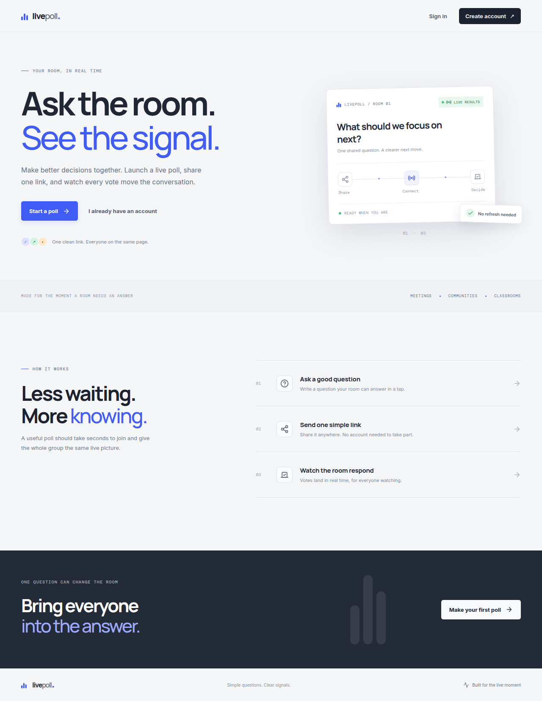
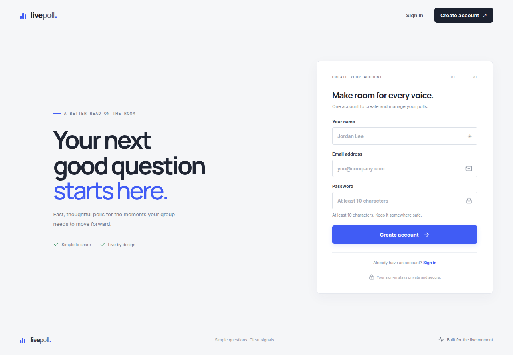
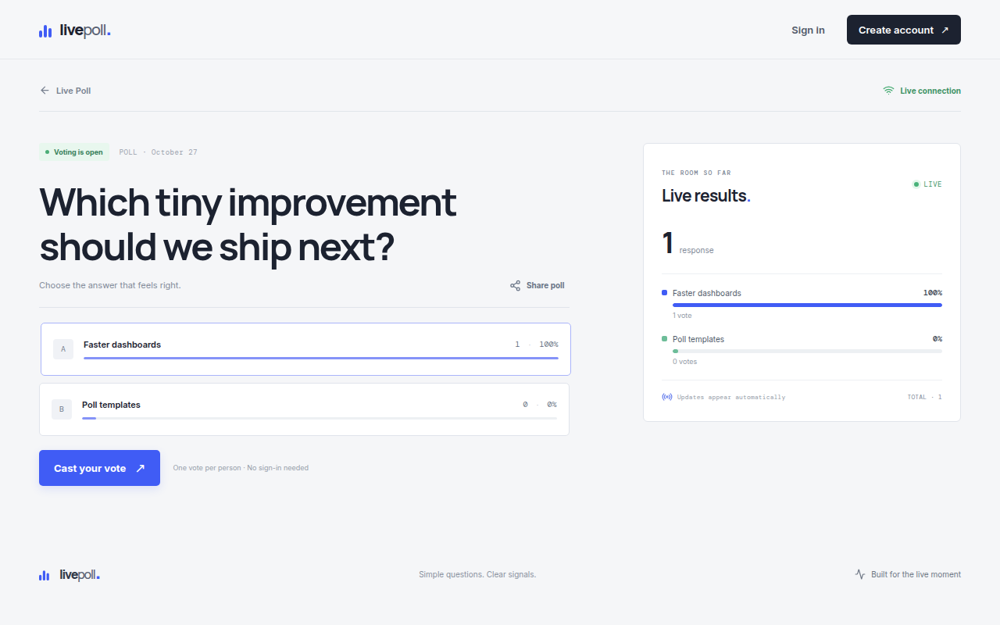
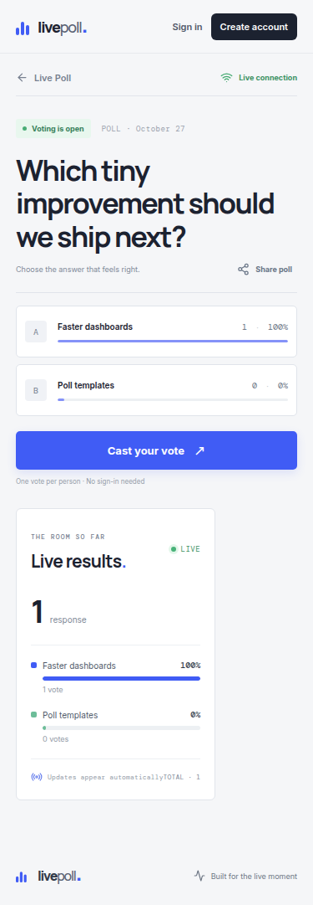

# Live Poll

Live Poll lets an owner ask a clear question, share one public link, and see the room's results move as votes arrive. Owners sign in to create and manage polls; visitors can vote without an account.

> **Release status (2026-10-27):** React production build, frontend tests, Go unit tests and a real MongoDB/Redis integration test pass locally. The integrated test covers login/signup/logout, poll creation, two separate anonymous cookie sessions, WebSocket subscribers, concurrent duplicate submissions and a simulated temporary Redis counter-update failure/reconciliation. The app is **not deployed or publicly available**; no public GitHub repository or recorded demo video is verified. Do not use this project for final internship submission until the external release steps are done.

## Product features

- Email/password signup, login and logout; bcrypt password hashes; opaque expiring MongoDB server sessions.
- Authenticated owner dashboard with owned polls, status/search filtering, share actions, and close/reopen controls.
- Poll creation with 2–10 distinct answer choices and copyable real share URL.
- Public, anonymous voting. MongoDB's unique `(pollId, voterId)` index prevents duplicate votes, including concurrent requests using the same already-initialized browser cookie.
- MongoDB persistence for users, polls, votes and sessions. Redis per-poll count hashes and Pub/Sub distribute live result events to WebSocket subscribers.
- Live snapshots, connection/reconnection/offline indicators, exponential retry, HTTP results fallback and snapshot resynchronization.
- Responsive React/TypeScript interface, visible keyboard focus, accessible form labels, reduced-motion support and inline validation/error states.

## Stack and architecture

```text
React + TypeScript (Vite, local port 3000)
        │ credentialed HTTP + WebSocket
        ▼
Go + Gin (local port 8080; serves same-origin SPA/API in the container)
   ├── MongoDB: users, polls, votes, sessions; durable source of truth
   └── Redis: poll count hashes, processed-vote IDs, rate limits,
             Pub/Sub event distribution between backend instances
```

`frontend/` and `backend/` are clearly separate. The Go backend is organized under `backend/internal/`: configuration, auth/session helpers, data models, validation, Mongo repository, domain services, HTTP routes/handlers/middleware, and Redis/WebSocket support. Business rules live in auth/poll services, not React or HTTP handlers. In production the same Go process serves the built React SPA and API, so the browser uses relative, same-origin HTTP and WebSocket URLs.

## Vote processing and recovery

1. A public poll read initializes a random HttpOnly `voter_id` cookie and a readable double-submit CSRF token. A vote request without this pre-existing voter cookie is rejected; voting does not mint a new identity on the request path, avoiding a simultaneous-first-request identity race.
2. The backend validates poll existence/status, option membership, CSRF and allowed origin, then inserts a durable MongoDB vote with a SHA-256 hash of the browser cookie. MongoDB's unique compound index is the acceptance gate. Invalid/duplicate votes never increment counters or broadcast vote events.
3. After the MongoDB insert, an atomic/idempotent Redis Lua operation updates the per-poll count hash using the durable vote ID. Only then is a live event published to Redis Pub/Sub; the backend relays it to WebSocket viewers. When realtime propagation is pending, the durable vote is retained, the HTTP result reports that state, and a background reconciler retries the outbox record every five seconds.
4. Redis Pub/Sub is transient and does not provide a durable event log. Results/reconnects use current MongoDB records; an initial WebSocket snapshot is sent after the Redis subscription is established so later events are not missed. The frontend ignores repeated vote IDs and fetches an authoritative snapshot on reconnect; a temporary HTTP fallback refreshes results while WebSockets are unavailable.
5. If Redis counters disappear or differ from MongoDB, the result service reads a durable vote snapshot. Under a short per-poll rebuild lock, a Lua script atomically seeds both the result hash and the set of accepted vote IDs represented in that same Mongo cursor snapshot. That makes an outbox retry for a just-rebuilt vote a no-op instead of a double increment. A newer concurrent Redis total is not overwritten by an older snapshot.

There is no distributed MongoDB/Redis transaction. MongoDB remains the durable authority; Mongo vote records plus `redisSynced` form the outbox/reconciliation mechanism. The per-poll Redis replay-protection set grows with accepted votes and the rebuild currently scans that poll's Mongo vote records. This is a correctness-first choice for the internship-size application, not a high-volume storage/retention strategy. The integration suite tests a counter-update failure induced by a held rebuild lock and subsequent reconciliation; it does **not** claim a full network outage or cross-backend-instance deployment test.

## MongoDB collections and indexes

- `users`: random ID, display name, normalized lowercase email, bcrypt hash and creation time; unique index on `email`.
- `polls`: random public ID, owner ID, question, stable option IDs/text, open/closed status and timestamps; compound `(ownerId, createdAt desc)` index.
- `votes`: random vote ID, poll ID, selected option ID, SHA-256 voter-cookie digest, creation time and `redisSynced`; unique `(pollId, voterId)` index, plus `(pollId, optionId)` and `(redisSynced, createdAt)` query indexes.
- `sessions`: opaque random token ID, user ID and expiry; TTL index on `expiresAt`.

Every public result request verifies/reconciles Redis against durable MongoDB results. This prioritizes correctness/recovery over eliminating a durable read for this small project.

## Redis keys

- `poll:<pollId>:counts` — hash with one option count per field plus `__total`.
- `poll:<pollId>:processed-votes` — set used by Lua to make a durable vote ID idempotent and by rebuild to restore replay protection.
- `poll:<pollId>:events` — Pub/Sub channel relayed to WebSocket clients on any backend instance.
- `rate:<route>:<hashed-client-address>` — fixed-window request counters for authentication and voting.

## Anonymous identity and security

A cryptographically random HttpOnly `voter_id` cookie is initialized on public poll detail/results reads. MongoDB stores only its hash. This enforces one accepted vote per poll per browser identity; it is not proof of a real person's identity. Clearing cookies, using another browser/device, or privacy settings can create a different anonymous identity. No name, email or IP is collected in vote records.

Passwords use bcrypt and are never returned. Session tokens are random opaque values stored in MongoDB with seven-day expiry; session and voter cookies are HttpOnly. A readable double-submit `csrf_token` must match `X-CSRF-Token`; mutating requests require the exact configured `Origin`. Set `COOKIE_SECURE=true` behind HTTPS. Secure cookies use `SameSite=None; Secure` for the HTTPS embedded Preview; plain HTTP local handling uses `SameSite=Lax`. CORS permits only `PUBLIC_ORIGIN`. JSON bodies are limited to 1 MiB and reject unknown fields. Auth/vote limits use Redis; rate limiting fails open during Redis failure, while poll ownership and durable vote uniqueness remain Mongo-enforced. Never commit production secrets.

## Project layout

```text
frontend/                         React + TypeScript app, pages, styles and UI tests
backend/cmd/server/               Go entrypoint, graceful shutdown, reconciliation loop
backend/internal/auth/            bcrypt, random tokens and session lookup
backend/internal/config/           environment configuration
backend/internal/httpapi/          Gin routes, JSON handlers, security middleware, WebSockets
backend/internal/live/              Redis counts/Lua idempotence, Pub/Sub, rate limits
backend/internal/model/             Mongo and JSON data models
backend/internal/service/            authentication and poll domain logic
backend/internal/store/              MongoDB connection, indexes and durable queries
backend/internal/validation/         shared backend input validation
backend/tests/                      opt-in integration suite using real MongoDB/Redis
frontend/src/pages/*.test.tsx        React form/voting behavior tests
frontend/src/poll/*.test.ts          live-result event reducer tests
docs/                                evaluation, demo script and email draft
Dockerfile                           multi-stage React/Go production container
docker-compose.yml                   local MongoDB and Redis
```

## API

All JSON failures use `{"error":"..."}`. Mutating API requests other than signup/login require same-origin `Origin` and matching double-submit `X-CSRF-Token`.

| Method | Path | Access | Behavior |
|---|---|---|---|
| POST | `/api/auth/signup` | Public | `{name,email,password}`; creates account/session; returns `{user}` |
| POST | `/api/auth/login` | Public | `{email,password}`; creates session; returns `{user}` |
| POST | `/api/auth/logout` | Session + CSRF | Expires Mongo session and cookies |
| GET | `/api/auth/me` | Session | Returns current `{user}` |
| POST | `/api/polls` | Session + CSRF | `{question,options:[string,...]}`; creates an owned poll |
| GET | `/api/polls` | Session | Owner's polls, newest first (maximum 100) |
| GET | `/api/polls/:id` | Public | Poll detail and `hasVoted` for a known cookie; initializes anonymous cookies |
| GET | `/api/polls/:id/results` | Public | `{poll,totalVotes,counts,percentages}`; initializes cookies and reconciles Redis/Mongo |
| POST | `/api/polls/:id/votes` | Public + CSRF | `{optionId}`; 201 accepted, 428 missing voter initialization, 409 duplicate/closed, 400 invalid input |
| POST | `/api/polls/:id/close` | Owner + CSRF | Closes voting and publishes a status event |
| POST | `/api/polls/:id/reopen` | Owner + CSRF | Reopens voting and publishes a status event |
| GET | `/api/ws/polls/:id` | Public, origin-checked | Sends `snapshot`, then Redis-backed `vote`/`status` events |
| GET | `/healthz` | Public | Process health |
| GET | `/readyz` | Public | Verifies MongoDB and Redis dependencies |

Poll IDs and bodies are validated by the backend; ownership is checked on every management operation. WebSocket data is public because polls are public; the server checks origin and poll existence before subscription.

## Local development

Prerequisites: Node.js 20+, pnpm 11, Go 1.22+, Docker Engine and Compose.

```bash
git clone <your-repository-url>
cd livepoll
cp .env.example .env
# MongoDB and Redis bind only to 127.0.0.1.
docker compose up -d mongodb redis

# Terminal 1: backend
cd backend
set -a; source ../.env; set +a
go mod download
go run ./cmd/server

# Terminal 2: frontend, from repository root
pnpm install
pnpm dev
```

Open `http://localhost:3000`. Vite proxies `/api`, `/healthz`, `/readyz` and WebSocket upgrades to Go on port 8080. Local sessions/polls use Mongo database `livepoll`.

### Automated checks

```bash
# Frontend typecheck + production build
pnpm --filter frontend build
# Frontend component/unit suite, one-shot
pnpm test
# Go unit and handler tests
(cd backend && go test ./...)
# Real MongoDB/Redis integration test (use a dedicated local Redis DB number)
(cd backend && MONGO_URI=mongodb://127.0.0.1:27017 REDIS_URL=redis://127.0.0.1:6379/11 go test -tags=integration -v ./tests)
```

**Verified locally:** the React production build succeeds; all 10 frontend tests pass; `go test ./...` passes; and `go test -tags=integration -v ./tests` passes against actual locally running MongoDB and Redis. That integration test verifies signup/login/logout/session invalidation, normalized-email uniqueness, authenticated poll creation, unauthenticated creation rejection, anonymous CSRF/voter-cookie bootstrap, invalid/closed/duplicate vote rejection, eight simultaneous same-cookie vote requests with exactly one accepted, Mongo persistence, Redis counters, two independent WebSocket subscribers receiving events, owner-only close/reopen and a pending Redis counter update reconciled after the cache is rebuilt including that vote. A secure Preview browser session additionally completed signup, poll creation, signed-out anonymous voting and displayed the backend-driven result. The automated API/WebSocket integration is not browser automation, an actual network outage test or a multi-backend-instance test.

`docker build`, `docker compose`, production deployment, cross-backend-instance behavior, public GitHub and final demo video are **not verified**; Docker is not installed in this project sandbox. Desktop and 375px mobile Preview screens were visually inspected and captured above. The React/Go source/build/test checks do not imply these release outcomes.

## Environment variables

See `.env.example`, `backend/.env.example` and `frontend/.env.example`. Backend: `PORT`, exact `PUBLIC_ORIGIN`, optional comma-separated exact `ALLOWED_ORIGINS`, `MONGO_URI`, `MONGO_DB`, `REDIS_URL`, `COOKIE_SECURE`, optional `COOKIE_DOMAIN`. Frontend: `VITE_API_BASE` and optional `VITE_WS_BASE`. For HTTPS Preview, set its exact origin and `COOKIE_SECURE=true`; do not use wildcards. Production should only allow its trusted public HTTPS app origin. Keep credentials in protected deployment environment/secret settings; MongoDB/Redis values are never embedded in browser assets.

## Production deployment

The root multi-stage Dockerfile builds React assets and the Go binary into one container. A host must support WebSocket upgrades and honor `PORT`. Provision external MongoDB and Redis with Pub/Sub support, then set `MONGO_URI`, `MONGO_DB`, `REDIS_URL`, exact HTTPS `PUBLIC_ORIGIN` and `COOKIE_SECURE=true`. The app serves the SPA and `/healthz`; `/readyz` checks dependencies. Restrict database access to the application service; protect and rotate credentials. Do not assume sandbox-local MongoDB/Redis are available in production.

**Live application URL:** not deployed or verified.
**Public GitHub repository URL:** not published or verified.
**3–5 minute demo video:** not recorded or hosted.

Remaining external work: authorize/provision a production host and MongoDB/Redis credentials; configure and deploy the container; verify signup/create/voting/WebSockets from two real browsers against the public HTTPS URL; publish a clean public GitHub repository; record and host the required demo showing the actual challenge and AI use; then submit the three verified links to `devhiring@hclguvi.com`. No public URL is invented here.

## Screenshots

Captured from the secured Preview during desktop and 375px mobile UI inspection. The poll shown is disposable synthetic test content; the one-vote total is a real MongoDB-accepted vote reflected in Redis/results, not a generated counter. These screenshots are evidence of a working Preview, not a public production deployment.









## Known limitations and trade-offs

Anonymous identity is cookie-based, not resistant to someone voting from multiple browser identities. There is no email verification, password reset, poll deletion or poll-question editing. The processed-vote Redis set grows linearly per poll, and a rebuild scans Mongo votes for that poll, so large-scale retention/performance needs a separate reviewed strategy. Result reads validate the cache against Mongo for correctness. Rate limiting fails open on Redis outage; auth and voting still depend on Mongo. Full network-failure testing, two-Go-instance deployment testing, automated two-browser live-relay verification, production container build, public deployment, GitHub and the hosted demo video remain unverified. Manual desktop and 375px mobile Preview inspection is complete; see the authentic captures above.
